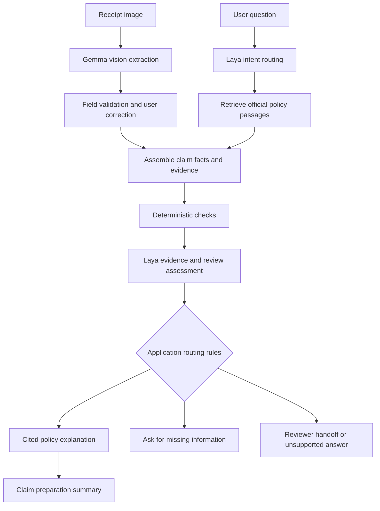

# Laya integration plan

Status: proposed design, not implemented or benchmarked. Researched on 24 October 2026.

## Interpretation and purpose

We interpret “laya for jev” as **Laya by Convai Innovations**, an open-weight decision model discussed as an alternative to Jev. The proposal integrates Laya directly; it does not assume a separate product named “Laya for Jev.”

Laya accepts text or JSON state and typed questions, returning constrained decisions and probabilities. The upstream Python interface uses `Router.predict` with `choice`, `score`, and `noul` questions. It offers English, multilingual, and typed-decision checkpoints under Apache 2.0. Upstream recommends domain specialisation and documents context and accuracy limits. These are capabilities and limitations described by the authors, not CampusClaim results. [Upstream README](https://github.com/NandhaKishorM/laya), [model card](https://huggingface.co/convaiinnovations/laya)

Our proposed use is a compact decision layer around receipt extraction and policy retrieval. It should reduce unnecessary generation and make review handoffs explicit. Whether it improves accuracy, latency, or cost must be measured.

## Responsibility of each component

| Component | Planned responsibility |
|---|---|
| Fine-tuned Gemma vision model | Extract the four required receipt fields from images. |
| User confirmation | Correct extracted text and supply purpose, category, approval status, or other missing context. |
| Deterministic validators | Validate JSON and required fields; parse totals and dates; compare explicit policy limits when scope, currency, and exceptions are known. |
| Retrieval pipeline | Fetch official policy passages with document, page, and version metadata. |
| Laya | Classify intent and assess whether supplied evidence warrants answering, clarification, or review. |
| Gemma answer generation | Explain the retrieved rules with citations and describe missing evidence. |
| Authorised college reviewer | Make reimbursement approval decisions. |

Laya receives text after extraction. It is not the receipt OCR/vision component. Its probability of a decision is not a confidence estimate for the original image extraction, and a high score is not proof of policy compliance.

## Proposed workflow

When Laya is disabled, unavailable, or unvalidated, keep the same receipt and RAG workflows available through direct user navigation and conservative manual review. Its failure should not prevent users from viewing extracted fields or sources.

## Initial decision tasks

| Task | Inputs | Candidate outputs | Application behavior |
|---|---|---|---|
| Request routing | User question and available upload metadata | `receipt_help`, `policy_question`, `claim_preparation`, `other` | Offer the relevant workflow; provide manual navigation if uncertain. |
| Expense category suggestion | User-confirmed receipt fields and stated event purpose | Categories defined by the selected college policy, plus `unknown` | Suggest a category for user confirmation. Merchant name alone cannot establish the purchase category. |
| Evidence sufficiency | Claim facts, question, and bounded retrieved passages | `supported`, `missing_facts`, `no_policy_evidence`, `conflicting_evidence` | Generate a cited answer only when evidence checks permit it; otherwise request details or route for review. |
| Review triage | Validator results and policy evidence | `prepare_draft`, `ask_user`, `manual_review`, `unsupported` | Prepare a draft or explicit handoff, with supporting passages visible. |

Start with request routing only. Add policy-evidence triage after labelling and evaluating realistic cases; it is the harder task. Keep unrelated domain labels out of each question's candidate set and always include a suitable unknown/review outcome.

## Application contracts

These are proposed CampusClaim interfaces, not a promise about Laya's native response schema.

`DecisionContext` contains:

- A request ID and user question.
- Receipt fields, user corrections, and missing-field indicators.
- Stated event purpose and approval information, preserving unknown values explicitly.
- A shortlist of policy passages with immutable source IDs, document versions, pages, and text.
- Deterministic validation results.

`DecisionResult` contains:

- Task name, selected label, and available label probabilities.
- Model/checkpoint revision, SDK version, question-schema version, and inference timing.
- Application-selected next step and fallback reason, if any.
- Source IDs supplied to the decision, rather than invented citations or model-generated rationales.

Keep source IDs separate from the model's choice. The UI should explain the application rule that triggered review and show the actual source passages. Do not represent decision scores as generated legal or policy reasoning.

## Inference and deployment approach

1. Prototype with the official Python package in a separate environment or service so its dependencies do not disrupt the Unsloth training notebook.
2. Wrap the documented SDK in a `DecisionProvider` adapter and normalise responses into the application contract. Confirm native schemas against a pinned release before implementing the adapter.
3. Evaluate the English and typed-decision checkpoints on our English routing tasks. Add multilingual evaluation only if multilingual input becomes part of the product scope.
4. Use compact claim state and relevant excerpts. Enforce token budgets against the selected checkpoint; surface context overflow instead of silently dropping important policy clauses.
5. Start local inference on available hardware, measure memory and cold/warm latency, and preload only the selected checkpoint if resources allow. Do not assume it fits alongside Gemma on a free T4 without measurement.
6. Add a feature flag, bounded inference time, schema validation, and manual-review fallbacks. Reject malformed or non-finite probability outputs.

Optional hosted access is documented by Vercel AI Gateway. Its announcement lists a free promotion ending 31 October 2026, after which the standard model ID begins billing and the promotional ID stops serving. Hosted inference is therefore an optional experiment, not the default free dependency for this project. Verify current terms before using it. [Provider announcement](https://vercel.com/changelog/laya-decision-model-now-available-on-ai-gateway-free-through-october-31)

Jev can be an optional hosted comparison only if access and budget are explicitly available. It is not required for the project, and it does not count toward the hackathon's four open-weight model requirement.

## Decision rules and fallbacks

- Missing required receipt fields trigger correction independently of any Laya score.
- No usable policy evidence triggers an unsupported response or review.
- Conflicting policy versions, unresolved exceptions, malformed responses, or inference failure trigger manual review.
- Explicit numerical policy checks remain deterministic and record which rule and inputs were used. Do not infer eligibility from an amount threshold alone.
- Tune score thresholds on validation data for each task. Never treat an arbitrary value such as 0.9 as a validated confidence threshold.
- Until local validation supports automated routing, run Laya in shadow mode: record its recommendation without letting it suppress evidence or approve a claim.

## Data and evaluation plan

SROIE annotates receipt fields, not reimbursement decisions. Build a separate labelled dataset for Laya from the actual policies and representative claim scenarios. Include missing documents, absent approvals, unknown categories, contradictory versions, misleading merchant names, unsupported questions, and near-boundary numerical cases.

Split training, validation, and test cases by scenario family and receipt to prevent near-duplicate leakage. Preserve document versions and reference passage IDs. Human-reviewed labels are required; synthetic cases may supplement them but must be identified. Use the validation split for thresholds and calibration, keeping the test set untouched.

Compare the following on the same cases:

1. Deterministic rules plus direct RAG, with manual review defaults.
2. Gemma prompted to return the same decision labels.
3. Off-the-shelf Laya.
4. Domain-adapted Laya, only if data and time support this extension.

Measure macro F1 and per-class precision/recall, incorrect routing into `prepare_draft`, supported-answer coverage, review rate, calibration error/Brier score where applicable, and cold/warm p50/p95 latency. Also measure citation correctness and end-to-end answer quality with and without Laya. Report model-only and complete workflow timing separately. Human review remains the reference for policy labels; Laya must not be the sole judge of its own outputs.

Before testing, agree the acceptable error and review rates with the team. Promote a task from shadow mode only when held-out results meet those criteria and show a practical benefit over the simpler baseline. Otherwise retain Laya as a visible comparison or disable that task. No project-specific quality or speed gains have yet been demonstrated.

## Delivery milestones

| Stage | Deliverable | Completion evidence |
|---|---|---|
| 1. Core project | Gemma extraction benchmark and cited RAG | Required 3B metrics and working policy retrieval. |
| 2. Contracts and labels | Decision schemas and a versioned scenario dataset | Reviewed labels, documented splits, explicit fallback cases. |
| 3. Routing prototype | Local adapter and shadow-mode request routing | Reproducible task metrics, hardware details, and timing. |
| 4. Evidence triage | Missing-information and review suggestions | Held-out comparison against rules and prompted Gemma. |
| 5. Optional specialisation | Domain-adapted Laya and calibrated thresholds | Separate validation/test results and reproducible training settings. |
| 6. Showcase | Toggle between baseline and Laya-assisted flows | Correct examples, uncertain cases, failures, and measured tradeoffs. |

## Relationship to theme selection

Theme 3B remains the primary submission: Gemma vision fine-tuning and receipt extraction. Laya is an additional decision component, not a substitute for that requirement. Theme 2A still requires official campus documents, citations, retrieved passages, refusals, and a 15-question evaluation. Theme 1 still requires its four-model, 25-prompt comparison; Laya's constrained decision benchmark should be reported separately from generative model tasks.

This extension makes CampusClaim's workflow explicit: **extract with Gemma, retrieve the evidence, assess the next step with Laya and application rules, and explain with citations.**
